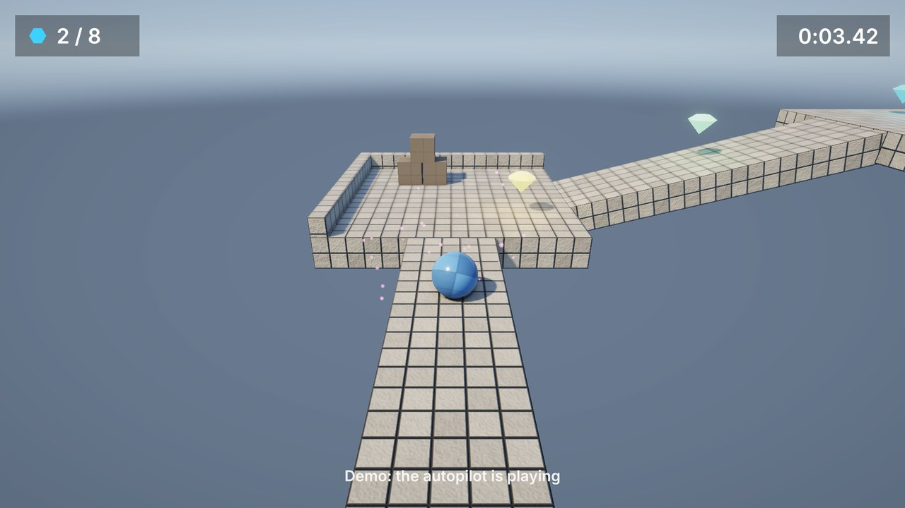

# LearnMetal Engine

A small game engine written entirely with Metal, twice: once in **Swift** and once in **C++** (with Apple's metal-cpp). It is the practical companion of the LearnMetal tutorials: what they explain one chapter at a time, put together into something you can make a game with.

It comes with **Marble**, a complete little game: roll through a course of floating platforms, collect eight gems, reach the goal. And with an **editor**, made with the engine itself, to build scenes without writing code. A second game, **FPV**, flies a racing drone through gates on an iPhone, an iPad or a Mac.

Three chapters of the tutorials walk through this code: [A Game Engine](https://gabrielevierti.github.io/learnmetal/in-practice/game-engine.html), [Engine: The Renderer](https://gabrielevierti.github.io/learnmetal/in-practice/engine-renderer.html) and [Engine: The Game](https://gabrielevierti.github.io/learnmetal/in-practice/engine-gameplay.html). A fourth, [Engine: The Editor](https://gabrielevierti.github.io/learnmetal/in-practice/engine-editor.html), covers the editor.



*This picture was made without a GPU: a test program ran the engine's own shaders on the CPU. See [What has been checked](#what-has-been-checked).*

## What is in it

**Rendering**

- Physically based materials (the metallic-roughness model of glTF), in HDR, with 4x multisampling
- One sun with cascaded shadow maps, plus up to 63 point and spot lights
- Image-based lighting generated from the sky at startup: irradiance map, prefiltered reflections, BRDF lookup table
- Normal maps, cut-out materials (with holes in their shadows too), transparent materials sorted back to front
- Automatic instancing, frustum culling, particles, debug lines
- Screen-space ambient occlusion, bloom, tone mapping, fog
- Shaders compiled at startup and reloaded when you save a `.metal` file

**2D**

- A canvas for interfaces and 2D games: rectangles, lines, circles, images, and text that stays sharp at any size (signed distance field fonts)

**Everything else a game needs**

- Entities and components, with parent-child transforms
- Physics with a fixed time step: spheres, boxes and capsules; static, kinematic and dynamic bodies; triggers, raycasts, collision layers
- Keyboard, mouse and gamepad, behind named actions ("jump", "moveX")
- Sound: a software mixer with volume, pitch, pan and looping; sounds from files or synthesized from a few numbers
- Assets: PNG and JPEG textures, OBJ models, fonts, audio files, loaded once and shared

**Editor**

- A scene editor built with the engine: a 3D view with a fly camera, click to select, handles to move, rotate and scale
- Panels for the entity list, every component, materials and their textures, the sky and the effects
- Scenes are saved as text files that read well in a diff; undo and redo; Play runs the physics and Stop puts everything back
- The interface is the engine's own immediate-mode `Gui`, which games can use too

**Tools**

- `--capture file.png` runs the game without a window and saves a frame: this is how the engine is tested on machines nobody looks at
- `--demo` lets an autopilot play Marble from start to goal: a test of everything at once
- F1 shows statistics, F2 draws the physics shapes, F3 toggles full screen, F4 saves a screenshot

## Run it

You need a Mac with macOS 13 or later and Xcode 15 or later (or its command line tools).

**Swift**

```sh
swift run Marble
```

**C++** (needs CMake 3.24 or later; the first configuration downloads GLFW, metal-cpp, stb and miniaudio)

```sh
cmake -B build -DCMAKE_BUILD_TYPE=Release
cmake --build build -j
./build/marble
```

| | Keyboard and mouse | Gamepad |
|---|---|---|
| Roll | W A S D | Left stick |
| Jump | Space | A |
| Look around | Arrow keys, or drag with the mouse | Right stick |
| Zoom | Scroll | |
| Start again | R | Start |
| Quit | Esc | Back |

## FPV, the drone game

Fly a racing drone from its own camera: a two-lap race through eight gates against the clock, or free flight over the same field. Angle mode levels the drone for you; Acro is how FPV pilots really fly. It is the Swift engine's first program for iOS (the engine now builds for macOS and iOS; the C++ version stays on the Mac).

```sh
swift run FPV                  # on a Mac: W S throttle, A D yaw, arrows pitch and roll
```

For iPhone and iPad, see [iOS/README.md](iOS/README.md): `xcodegen generate`, open the project, press Run. Two thumbs on the screen, a game controller, or an RC radio that can act as a gamepad.

## The editor


```sh
swift run Editor demo          # Swift
./build/editor demo            # C++
```

`demo` is a scene in `Assets/Scenes`; without a name the editor starts a new one.

| | |
|---|---|
| Look around and fly | Hold the right mouse button, then W A S D, Q and E |
| Select | Left click, in the view or in the list |
| Move, rotate, scale | W, E, R, then drag a colored handle |
| Look at the selection | F |
| Change a number | Drag it sideways, or click it and type |
| Save, undo, redo, duplicate | Ctrl+S, Ctrl+Z, Ctrl+Y, Ctrl+D |
| Delete | Backspace |
| Play and stop | F5 |

A game loads what the editor saved with one call:

```swift
var materials: [NamedMaterial] = []
loadSceneFile(engine.assets.path("Scenes/demo.scene"), into: engine.scene, materials: &materials,
              settings: &engine.renderer.settings, assets: engine.assets.sceneAssets)
```

```cpp
std::vector<NamedMaterial> materials;
loadSceneFile(engine.assets().path("Scenes/demo.scene"), engine.scene, materials, engine.renderer().settings,
              sceneAssets(engine.assets()));
```

The editor does not attach game logic: a scene file holds entities and the engine's own components. What a game adds on top (Marble's gems, its moving platform) stays in code.

Both games and the editor take the same options: `--fullscreen`, `--width N`, `--height N`, `--demo`, `--capture FILE.png`, `--frames N`, `--scale N`.

## The smallest game

A spinning cube, lit by a sun. In Swift:

```swift
import Foundation
import LMEngine
import simd

final class Spin: Game {
    var cube = Entity.invalid

    func start(_ engine: Engine) {
        let scene = engine.scene

        let camera = scene.create("Camera")
        scene.add(camera, Transform(position: Vec3(0, 1.5, 4), rotation: .lookRotation(forward: Vec3(0, -0.35, -1))))
        scene.add(camera, Camera())

        let sun = scene.create("Sun")
        scene.add(sun, Transform(rotation: .lookRotation(forward: Vec3(0.4, -1, -0.3))))
        scene.add(sun, Light(type: .directional, intensity: 3, castsShadows: true))

        cube = scene.create("Cube")
        scene.add(cube, Transform())
        scene.add(cube, MeshRenderer(mesh: engine.assets.cube, material: engine.assets.makeMaterial(baseColor: Vec4(0.9, 0.4, 0.1, 1))))
    }

    func update(_ engine: Engine, dt: Float) {
        engine.scene[cube, Transform.self]?.rotation = Quat(angle: Float(engine.time.elapsed), axis: Vec3(0, 1, 0))
    }
}

let engine = Engine(config: EngineConfig.fromArguments(CommandLine.arguments))
exit(engine.run(Spin()))
```

And in C++:

```cpp
#include "LMEngine.hpp"
using namespace lm;

struct Spin : Game {
    Entity cube;

    void start(Engine& engine) override {
        Scene& scene = engine.scene;

        Entity camera = scene.create("Camera");
        Transform view;
        view.position = Vec3{0, 1.5f, 4};
        view.rotation = lookRotation(Vec3{0, -0.35f, -1});
        scene.add(camera, view);
        scene.add(camera, Camera{});

        Entity sun = scene.create("Sun");
        Transform sunDirection;
        sunDirection.rotation = lookRotation(Vec3{0.4f, -1, -0.3f});
        scene.add(sun, sunDirection);
        Light light;
        light.type = LightType::Directional;
        light.intensity = 3;
        light.castsShadows = true;
        scene.add(sun, light);

        cube = scene.create("Cube");
        scene.add(cube, Transform{});
        scene.add(cube, MeshRenderer{engine.assets().cube(), engine.assets().makeMaterial(Vec4{0.9f, 0.4f, 0.1f, 1})});
    }

    void update(Engine& engine, float) override {
        engine.scene.get<Transform>(cube)->rotation = axisAngle(Vec3{0, 1, 0}, float(engine.time.elapsed));
    }
};

int main(int argc, char** argv) {
    Engine engine(EngineConfig::fromArguments(argc, argv));
    Spin game;
    return engine.run(game);
}
```

`Swift/Marble` and `Cpp/marble` are the full example: a level, physics, sounds, an interface and an autopilot, in about 800 lines. `Swift/Editor` and `Cpp/editor` are a larger one: about 1100 lines each.

## One engine, two languages

The two versions are the same program. A Swift file and the C++ file of the same name hold the same functions and the same comments, so you can read them side by side. The only files without a twin are glue for a library: `ImageDecoder.swift` (ImageIO) on one side, and on the other the few C++ files that set up GLFW, metal-cpp, stb and miniaudio. Two things are not duplicated at all:

- **The shaders** in `Shaders/`. Both engines compile the same `.metal` files when they start.
- **The data that crosses to the GPU.** `Shaders/Shared/ShaderTypes.h` declares every uniform struct and every binding slot once. The shaders include it, the C++ engine includes it, and Swift imports it as a module. A struct cannot have one layout on the CPU and another in a shader.

Where the languages genuinely differ, the code differs: C++ opens its window with GLFW and plays sound through miniaudio; Swift uses AppKit, MetalKit and AVAudioEngine. In C++ a component is reached through a pointer; in Swift it is a value you read, change and store back.

## From the tutorials to the engine

| In the tutorials | In the engine |
|---|---|
| Hello Triangle, Shaders | `Rendering/ShaderLibrary`, `Shaders/Common.metal` |
| Textures | `Rendering/Texture`, `Assets/Assets` |
| Transformations, Coordinate Systems, Camera | `Math/Math`, `Scene/Scene`, `Scene/Components` |
| Materials, Light Casters, Multiple Lights | `Rendering/Material`, `Shaders/Lighting.metal` |
| Model Loading | `Assets/MeshData` (its own OBJ reader) |
| Depth Testing, Blending, Face Culling | `Rendering/RenderPasses` |
| Render Targets, Anti-Aliasing | `Rendering/Renderer`, `Rendering/GraphicsDevice` |
| Cubemaps | `Rendering/Environment`, `Shaders/Sky.metal` |
| Instancing | `Renderer.makeBatches` |
| Gamma Correction, HDR, Bloom | `Shaders/Post.metal` |
| Shadow Mapping | `Rendering/Cascades`, `sunVisibility` in `Shaders/Lighting.metal` |
| Normal Mapping | `Assets/MeshData` (tangents), `Shaders/Forward.metal` |
| SSAO | `Shaders/Post.metal`, `Renderer.renderOcclusion` |
| PBR, Diffuse Irradiance, Specular IBL | `Shaders/Lighting.metal`, `Shaders/IBL.metal` |
| Debugging | labels and debug groups in every pass, `Rendering/DebugDraw` |
| Text Rendering, A 2D Game | `Rendering/Canvas`, `Assets/Font`, `Tools/bake_font.py` |
| Tile-Based GPUs | memoryless targets and load/store actions in `Rendering/Renderer` |

[ARCHITECTURE.md](ARCHITECTURE.md) explains how the pieces fit: the frame, the passes, the conventions.

## What is where

```
Shaders/            the Metal shaders, shared by both engines
  Shared/           ShaderTypes.h: structs and binding slots for shaders, C++ and Swift
Assets/             fonts, textures, a model and a sample scene
Swift/LMEngine/     the engine in Swift
Swift/Marble/       the game in Swift
Swift/Editor/       the editor in Swift
Swift/FPVKit/       FPV, the drone game (flight model, track, controls, screens)
Swift/FPV/          FPV as a Mac program
iOS/                FPV as an iPhone and iPad app
Swift/Tests/        unit tests (XCTest)
Cpp/engine/         the engine in C++
Cpp/marble/         the game in C++
Cpp/editor/         the editor in C++
Cpp/tests/          unit tests
Tools/              bake_font.py and make_assets.py
```

## What has been checked

This engine was written on a Linux machine, without a Mac, a GPU or a Swift compiler. Here is exactly what was and was not verified, so you know where to look first if something does not build.

| | Checked | Not checked |
|---|---|---|
| **C++ engine and game** | 46 of the 47 C++ files compile for macOS on Apple silicon against Apple's real metal-cpp and simd headers (the few Core Foundation and Core Graphics types those headers mention came from small stand-in headers). The remaining file, `ThirdParty.cpp`, only pulls in the stb and miniaudio implementations and was compiled on Linux. 82 unit tests pass (80 run on Linux, the 2 for scene files on the stand-in described next). The whole engine, the game and the editor were then run against a software stand-in for Metal, written for this purpose, which executes the real shaders on the CPU: the autopilot finishes the course, and the stand-in's checks (reference counting, pass and pipeline formats, missing bindings, values that are not numbers) report nothing. The editor was driven there by scripted mouse and keyboard input: switching tabs, choosing from a list, dragging a handle, undo, play and stop, and saving a scene that reopens identical. | Never linked on a Mac. Never run on a real GPU. The Objective-C++ file that attaches the Metal layer to the window (`MetalLayerBridge.mm`, 24 lines) was not compiled at all. |
| **Shaders** | Type-checked by compiling them as C++ against a stand-in for the Metal standard library, and executed on the CPU to produce the pictures in this file, the editor's included. | Never compiled by Apple's Metal compiler. |
| **Swift engine and game** | A parser confirms the syntax is valid, and a script confirms that calls to the engine's own functions use labels that exist. It is a file-by-file port of the C++ code that was tested. | **Never compiled.** Expect compile errors in the Swift version the first time; the most likely places are `Platform/Window.swift`, `Audio/Audio.swift` and `Rendering/ImageDecoder.swift`, which talk to AppKit, AVFoundation and Core Graphics. The Swift editor, the FPV game with its iOS app, and the 86 Swift tests are in the same state. The flight model's math was checked numerically with an equivalent script (hover, the direction each stick moves the drone, recovery in angle mode), not by running the Swift. |

The workflow in `.github/workflows/ci.yml` builds both versions on a Mac, runs the tests, lets the autopilot play the course, opens the sample scene in the editor, attaches the pictures, and builds the iPhone app for the simulator. The first push to GitHub is therefore the first real test.

## Not there yet

In the editor: one selection at a time, no scripting, no drag and drop, and Ctrl where a Mac user expects Command. In the engine: stencil effects (outlines), a deferred path, shadows from point lights, parallax mapping, glTF and skinned animation, tessellation, ray tracing, mesh shaders, MetalFX, Metal 4, visionOS, iOS. The physics has no rotation from impacts and no joints.

## Credits

- The interface font is [Inter](https://rsms.me/inter/) by Rasmus Andersson, under the SIL Open Font License (`Assets/Fonts/Inter-LICENSE.txt`).
- The C++ version downloads at build time: [GLFW](https://www.glfw.org) (zlib license), [metal-cpp](https://developer.apple.com/metal/cpp/) (Apache 2.0, from a mirror), [stb](https://github.com/nothings/stb) (public domain or MIT) and [miniaudio](https://miniaud.io) (public domain or MIT No Attribution). None of their code is in this repository.

© 2026 Gabriele Vierti. No license has been chosen for this code yet; until one is added, all rights are reserved.
