<div align="center">

<picture>
  <source media="(prefers-color-scheme: dark)" srcset="Docs/readme/banner-dark.svg">
  
</picture>

<p>
  <a href="#run-it"><b>Run it</b></a> ·
  <a href="#fpv-the-drone-game"><b>FPV</b></a> ·
  <a href="#the-editor"><b>Editor</b></a> ·
  <a href="#the-smallest-game"><b>Smallest game</b></a> ·
  <a href="#from-the-tutorials-to-the-engine"><b>From the tutorials</b></a> ·
  <a href="ARCHITECTURE.md"><b>Architecture</b></a>
</p>

</div>

**LearnMetal Engine** is a small game engine written entirely with Metal, twice: once in **Swift** and once in **C++** with Apple's metal-cpp. It is the practical companion to the [LearnMetal](https://gabrielevierti.github.io/learnmetal/) tutorials: what they explain one chapter at a time, put together into something you can make a game with.

It ships with **Marble**, a complete little game (roll through a course of floating platforms, collect eight gems, reach the goal), an **editor** made with the engine itself to build scenes without writing code, and **FPV**, a second game that flies a racing drone through gates on an iPhone, an iPad or a Mac.


<picture>
  <source media="(prefers-color-scheme: dark)" srcset="Docs/readme/features-dark.svg">
  
</picture>

**Read along.** Four chapters of the tutorials walk through this code: [A Game Engine](https://gabrielevierti.github.io/learnmetal/in-practice/game-engine.html), [Engine: The Renderer](https://gabrielevierti.github.io/learnmetal/in-practice/engine-renderer.html), [Engine: The Game](https://gabrielevierti.github.io/learnmetal/in-practice/engine-gameplay.html) and [Engine: The Editor](https://gabrielevierti.github.io/learnmetal/in-practice/engine-editor.html).

## Run it

You need a Mac with **macOS 13+** and **Xcode 15+** (or its command line tools).

**Swift**

```sh
swift run Marble
```

**C++** (needs CMake 3.24+; the first configuration downloads GLFW, metal-cpp, stb and miniaudio)

```sh
cmake -B build -DCMAKE_BUILD_TYPE=Release
cmake --build build -j
./build/marble
```

| | Keyboard and mouse | Gamepad |
|---|---|---|
| Roll | W A S D | Left stick |
| Jump | Space | A |
| Look around | Arrow keys, or drag with the mouse | Right stick |
| Zoom | Scroll | |
| Start again | R | Start |
| Quit | Esc | Back |

Both games and the editor take the same options: `--fullscreen`, `--width N`, `--height N`, `--demo`, `--capture FILE.png`, `--frames N`, `--scale N`.

## What's inside

<table>
<tr>
<td valign="top" width="50%">

**Rendering**

- Physically based materials (glTF metallic-roughness) in HDR, with 4× multisampling
- One sun with cascaded shadow maps, plus up to 63 point and spot lights
- Image-based lighting generated from the sky at startup: irradiance, prefiltered reflections, BRDF lookup table
- Normal maps; cut-out materials (with holes in their shadows too); transparent materials sorted back to front
- Automatic instancing, frustum culling, particles, debug lines
- Screen-space ambient occlusion, bloom, tone mapping, fog
- A sky with drifting clouds that also lights the scene
- A camera that can look filmed: lens distortion, colour fringes, grain, the tearing of a weak video link
- Shaders compiled at startup and reloaded when you save a `.metal` file

**2D**

- A canvas for interfaces and 2D games: rectangles, rounded rectangles, lines, circles, rings, arcs, polygons, images, and text that stays sharp at any size (signed distance field fonts)
- Smooth edges without multisampling, and clipping to a rectangle

</td>
<td valign="top" width="50%">

**Everything else a game needs**

- Entities and components, with parent-child transforms
- Fixed-step physics: spheres, boxes and capsules; static, kinematic and dynamic bodies; triggers, raycasts, collision layers
- Keyboard, mouse and gamepad behind named actions (`"jump"`, `"moveX"`)
- Sound: a software mixer with volume, pitch, pan and looping, playing files or sounds synthesized from a few numbers
- Assets: PNG and JPEG textures, OBJ models, fonts, audio files, loaded once and shared
- Things made in code: boxes, spheres, cylinders, cones, terrain from a height function, computed textures, noise

**Tools**

- `--capture file.png` runs the game without a window and saves a frame: this is how the engine is tested on machines nobody looks at
- `--demo` lets an autopilot play Marble from start to goal, a test of everything at once
- **F1** statistics · **F2** physics shapes · **F3** full screen · **F4** screenshot

</td>
</tr>
</table>

## FPV, the drone game

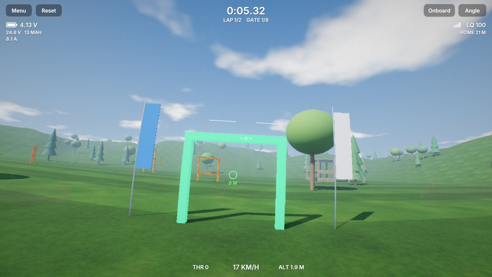

Fly a racing drone from its own camera: a two-lap race through eight gates against the clock, or free flight over a field with trees to round and an unfinished building to thread.

The drone is **simulated, not animated**. It is a rigid body with four motors, and everything a pilot feels comes out of the physics:

- **Motors and propellers.** Thrust grows with the square of motor speed, so a strong quad hovers on a quarter of its throttle. Motors take time to change speed, and thrust fades as the drone goes faster, which together with drag sets the top speed.
- **A flight controller.** Betaflight's "Actual" rates turn the sticks into rotation rates; a PID loop per axis and a mixer with air mode turn those into four motor commands. The gains are worked out from the airframe.
- **Air.** Drag that depends on which side faces the wind, the cushion of air near the ground, the wobble of sinking through your own propwash, and gusty wind.
- **A battery.** A lithium pack that sags under load and empties in minutes: full throttle pulls a hundred amps and the voltage shows it.
- **Crashes.** A light touch is a bounce. A hard one stops the motors and the drone tumbles; once it lies still it is turned over, and the motors restart when the throttle is down.
- **A radio link.** It weakens with distance and behind obstacles. The picture tears before the link drops, and when it drops the motors stop.

Two drones are built in: a **5-inch freestyle quad** on six cells (650 g, about 130 km/h) and a **2-inch ducted whoop** on two cells, 95 mm across, the size of a BETAFPV Cetus X (82 g, about 50 km/h). Angle mode levels the drone for you; Acro is how FPV pilots really fly.

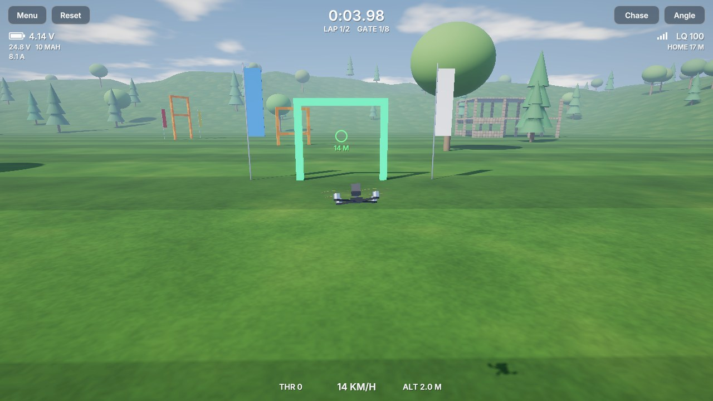

```sh
swift run FPV                  # Swift, on a Mac
./build/fpv                    # C++
```

| | Keyboard | Controller |
|---|---|---|
| Throttle (it stays where you leave it) | W S | Left stick, up and down |
| Yaw | A D | Left stick, sideways |
| Pitch and roll | Arrow keys | Right stick |
| Start again | R | A |
| Angle or Acro | M | X |
| Onboard or chase view | C | Y |
| Menu | Esc | B |

`--race` and `--free` skip the menu, `--whoop` picks the small drone, and `--acro` and `--chase` do what they say.

**On iPhone and iPad** the game is the Swift version with two sticks on the screen, and it also works with a game controller or an RC radio in gamepad mode. Run `xcodegen generate`, open the project and press Run: details in [iOS/README.md](iOS/README.md).

## The editor

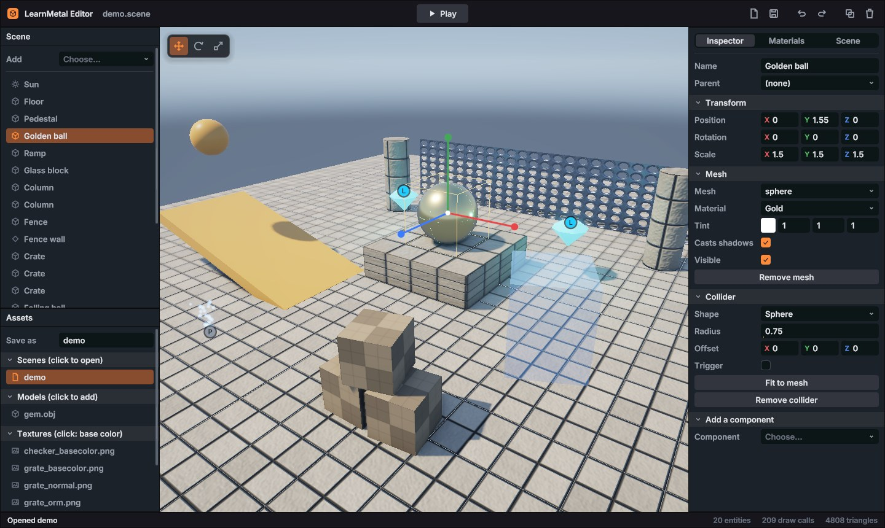

```sh
swift run Editor demo          # Swift
./build/editor demo            # C++
```

`demo` is a scene in `Assets/Scenes`; without a name the editor starts a new one.

- A 3D view with a fly camera; click to select, then handles to move, rotate and scale
- Panels for the entity list, every component, materials and their textures, the sky and the effects
- Scenes saved as text files that read well in a diff; undo and redo; **Play** runs the physics and **Stop** puts everything back
- The interface is the engine's own immediate-mode `Gui`, which games can use too: scrolling panels, folding sections, draggable number fields, lists, pop-ups, tooltips and icons drawn in code

| | |
|---|---|
| Look around and fly | Hold the right mouse button, then W A S D, Q and E |
| Select | Left click, in the view or in the list |
| Move, rotate, scale | W, E, R, then drag a coloured handle |
| Look at the selection | F |
| Change a number | Drag it sideways, or click it and type |
| Save, undo, redo, duplicate | Ctrl+S, Ctrl+Z, Ctrl+Y, Ctrl+D |
| Delete | Backspace |
| Play and stop | F5 |

A game loads what the editor saved with one call:

```swift
var materials: [NamedMaterial] = []
loadSceneFile(engine.assets.path("Scenes/demo.scene"), into: engine.scene, materials: &materials,
              settings: &engine.renderer.settings, assets: engine.assets.sceneAssets)
```

```cpp
std::vector<NamedMaterial> materials;
loadSceneFile(engine.assets().path("Scenes/demo.scene"), engine.scene, materials, engine.renderer().settings,
              sceneAssets(engine.assets()));
```

The editor doesn't attach game logic: a scene file holds entities and the engine's own components. What a game adds on top (Marble's gems, its moving platform) stays in code.

<details>
<summary><b>More screenshots</b></summary>

<br>

| | |
|---|---|
| 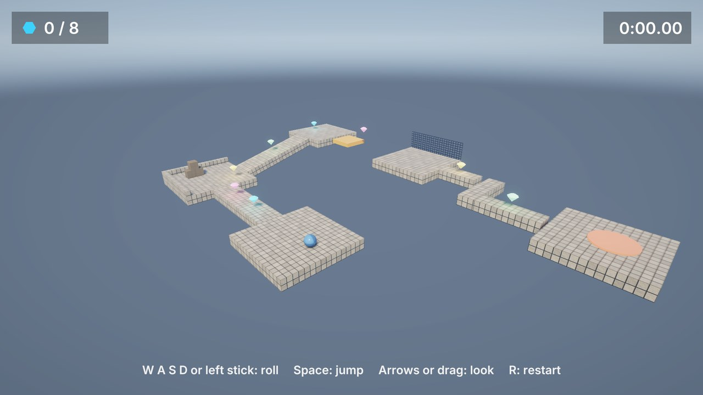 | 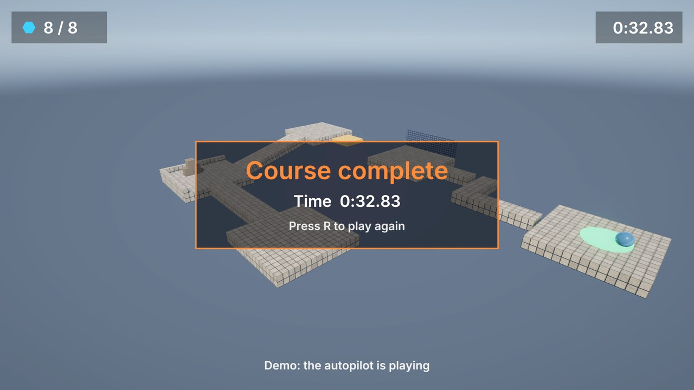 |
| 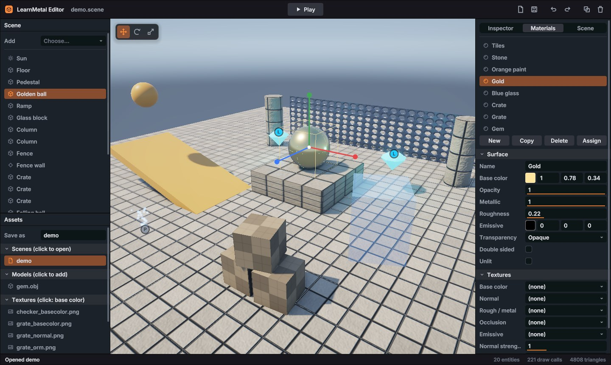 | 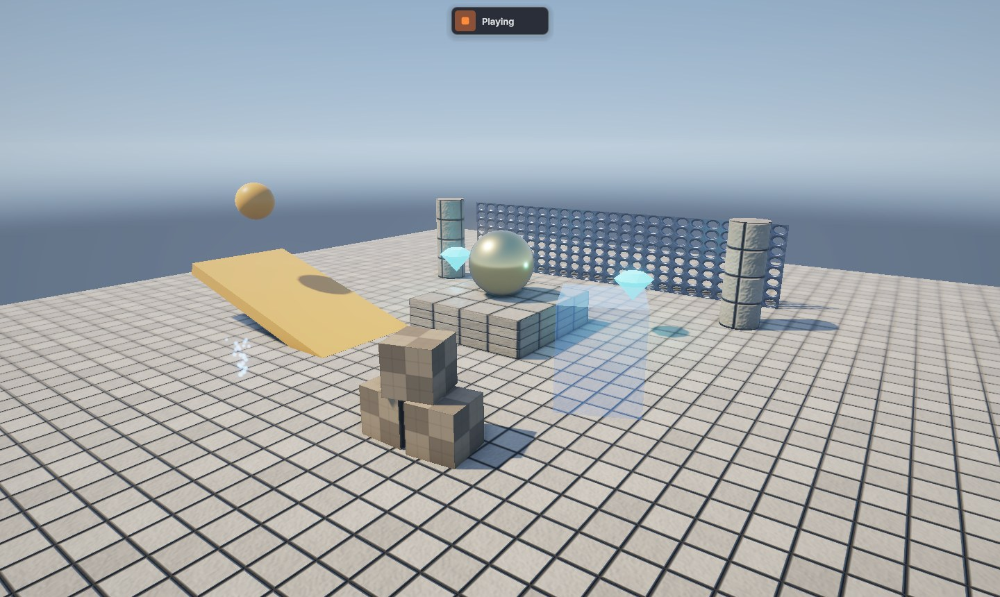 |
| 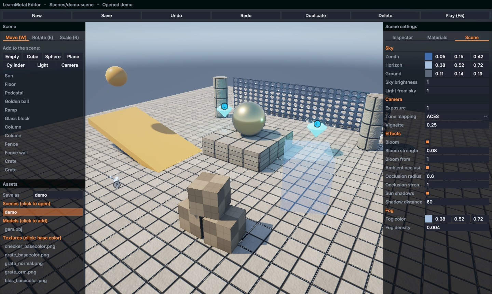 | 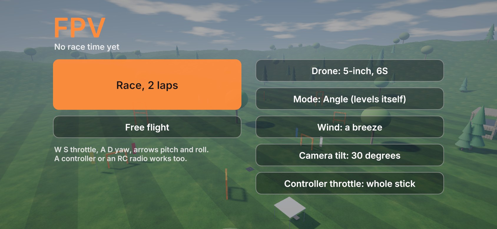 |

</details>

## The smallest game

A spinning cube, lit by a sun.

<table>
<tr><th>Swift</th><th>C++</th></tr>
<tr>
<td valign="top">

```swift
import Foundation
import LMEngine
import simd

final class Spin: Game {
    var cube = Entity.invalid

    func start(_ engine: Engine) {
        let scene = engine.scene

        let camera = scene.create("Camera")
        scene.add(camera, Transform(position: Vec3(0, 1.5, 4),
            rotation: .lookRotation(forward: Vec3(0, -0.35, -1))))
        scene.add(camera, Camera())

        let sun = scene.create("Sun")
        scene.add(sun, Transform(rotation:
            .lookRotation(forward: Vec3(0.4, -1, -0.3))))
        scene.add(sun, Light(type: .directional, intensity: 3,
            castsShadows: true))

        cube = scene.create("Cube")
        scene.add(cube, Transform())
        scene.add(cube, MeshRenderer(mesh: engine.assets.cube,
            material: engine.assets.makeMaterial(
                baseColor: Vec4(0.9, 0.4, 0.1, 1))))
    }

    func update(_ engine: Engine, dt: Float) {
        engine.scene[cube, Transform.self]?.rotation =
            Quat(angle: Float(engine.time.elapsed), axis: Vec3(0, 1, 0))
    }
}

let engine = Engine(config: EngineConfig.fromArguments(CommandLine.arguments))
exit(engine.run(Spin()))
```

</td>
<td valign="top">

```cpp
#include "LMEngine.hpp"
using namespace lm;

struct Spin : Game {
    Entity cube;

    void start(Engine& engine) override {
        Scene& scene = engine.scene;

        Entity camera = scene.create("Camera");
        Transform view;
        view.position = Vec3{0, 1.5f, 4};
        view.rotation = lookRotation(Vec3{0, -0.35f, -1});
        scene.add(camera, view);
        scene.add(camera, Camera{});

        Entity sun = scene.create("Sun");
        Transform sunDirection;
        sunDirection.rotation = lookRotation(Vec3{0.4f, -1, -0.3f});
        scene.add(sun, sunDirection);
        Light light;
        light.type = LightType::Directional;
        light.intensity = 3;
        light.castsShadows = true;
        scene.add(sun, light);

        cube = scene.create("Cube");
        scene.add(cube, Transform{});
        scene.add(cube, MeshRenderer{engine.assets().cube(),
            engine.assets().makeMaterial(Vec4{0.9f, 0.4f, 0.1f, 1})});
    }

    void update(Engine& engine, float) override {
        engine.scene.get<Transform>(cube)->rotation =
            axisAngle(Vec3{0, 1, 0}, float(engine.time.elapsed));
    }
};

int main(int argc, char** argv) {
    Engine engine(EngineConfig::fromArguments(argc, argv));
    Spin game;
    return engine.run(game);
}
```

</td>
</tr>
</table>

`Swift/Marble` and `Cpp/marble` are the full example: a level, physics, sounds, an interface and an autopilot, in about 800 lines. `Swift/Editor` and `Cpp/editor` are a larger one, about 1100 lines each.

## One engine, two languages

The two versions are the same program. A Swift file and the C++ file of the same name hold the same functions and the same comments, so you can read them side by side. The only files without a twin are glue for a library: `ImageDecoder.swift` (ImageIO) on one side, and on the other the few C++ files that set up GLFW, metal-cpp, stb and miniaudio.

Two things aren't duplicated at all:

- **The shaders** in `Shaders/`. Both engines compile the same `.metal` files at startup.
- **The data that crosses to the GPU.** `Shaders/Shared/ShaderTypes.h` declares every uniform struct and binding slot once. The shaders include it, the C++ engine includes it, and Swift imports it as a module, so a struct can't have one layout on the CPU and another in a shader.

Where the languages genuinely differ, the code differs: C++ opens its window with GLFW and plays sound through miniaudio, while Swift uses AppKit, MetalKit and AVAudioEngine. In C++ a component is reached through a pointer; in Swift it is a value you read, change and store back.

## From the tutorials to the engine

| In the tutorials | In the engine |
|---|---|
| Hello Triangle, Shaders | `Rendering/ShaderLibrary`, `Shaders/Common.metal` |
| Textures | `Rendering/Texture`, `Assets/Assets` |
| Transformations, Coordinate Systems, Camera | `Math/Math`, `Scene/Scene`, `Scene/Components` |
| Materials, Light Casters, Multiple Lights | `Rendering/Material`, `Shaders/Lighting.metal` |
| Model Loading | `Assets/MeshData` (its own OBJ reader) |
| Depth Testing, Blending, Face Culling | `Rendering/RenderPasses` |
| Render Targets, Anti-Aliasing | `Rendering/Renderer`, `Rendering/GraphicsDevice` |
| Cubemaps | `Rendering/Environment`, `Shaders/Sky.metal` |
| Instancing | `Renderer.makeBatches` |
| Gamma Correction, HDR, Bloom | `Shaders/Post.metal` |
| Shadow Mapping | `Rendering/Cascades`, `sunVisibility` in `Shaders/Lighting.metal` |
| Normal Mapping | `Assets/MeshData` (tangents), `Shaders/Forward.metal` |
| SSAO | `Shaders/Post.metal`, `Renderer.renderOcclusion` |
| PBR, Diffuse Irradiance, Specular IBL | `Shaders/Lighting.metal`, `Shaders/IBL.metal` |
| Debugging | Labels and debug groups in every pass, `Rendering/DebugDraw` |
| Text Rendering, A 2D Game | `Rendering/Canvas`, `Assets/Font`, `Tools/bake_font.py` |
| Tile-Based GPUs | Memoryless targets and load/store actions in `Rendering/Renderer` |

[ARCHITECTURE.md](ARCHITECTURE.md) explains how the pieces fit: the frame, the passes, the conventions.

## Project layout

```text
Shaders/            the Metal shaders, shared by both engines
  Shared/           ShaderTypes.h: structs and binding slots for shaders, C++ and Swift
Assets/             fonts, textures, a model and a sample scene
Swift/LMEngine/     the engine in Swift
Swift/Marble/       the game in Swift
Swift/Editor/       the editor in Swift
Swift/FPVKit/       FPV, the drone game (flight model, track, world, controls, screens)
Swift/FPV/          FPV as a Mac program
iOS/                FPV as an iPhone and iPad app
Swift/Tests/        97 unit tests (XCTest)
Cpp/engine/         the engine in C++
Cpp/marble/         the game in C++
Cpp/editor/         the editor in C++
Cpp/fpv/            FPV in C++ (keyboard and controller; touch controls are Swift-only)
Cpp/tests/          100 tests in C++
Tools/              bake_font.py and make_assets.py
```

Run the tests with `swift test`.

## Not there yet

- **Editor:** one selection at a time, no scripting, no drag and drop, and Ctrl where a Mac user expects Command.
- **Engine:** stencil effects (outlines), a deferred path, shadows from point lights, parallax mapping, glTF and skinned animation, tessellation, ray tracing, mesh shaders, MetalFX, Metal 4, visionOS.
- **Platforms:** only the Swift version runs on iOS.
- **Physics:** no rotation from impacts and no joints.

## Credits

- The interface font is [Inter](https://rsms.me/inter/) by Rasmus Andersson, under the SIL Open Font License (`Assets/Fonts/Inter-LICENSE.txt`).
- The C++ version downloads at build time [GLFW](https://www.glfw.org) (zlib license), [metal-cpp](https://developer.apple.com/metal/cpp/) (Apache 2.0, from a mirror), [stb](https://github.com/nothings/stb) (public domain or MIT) and [miniaudio](https://miniaud.io) (public domain or MIT No Attribution). None of their code is in this repository.

## License

GPL-3.0. See [LICENSE](LICENSE).

---

<sub>© 2026 <a href="https://github.com/gabrielevierti">Gabriele Vierti</a>, Milan.</sub>
